# Bitcoin Behavioral-Cloning Trading Bot & Quantitative Trading Guide

This guide explains **how your Bitcoin trading bot works under the hood** (from data scraping and machine learning to live execution) and **the core quantitative trading concepts** (Risk-to-Reward, Win-Rate break-even math, Taker Fees, Slippage, Orderbook Depth, and Leverage) that determine whether a strategy makes or loses money in the real world.

---

## Part 1: High-Level Architecture Overview

Your bot uses a machine learning technique called **Behavioral Cloning** (a branch of Imitation Learning). Instead of trying to predict the exact dollar price of Bitcoin tomorrow—which fails whenever Bitcoin enters a new price regime—the bot studies **what a profitable trader does** in response to **normalized market conditions** and learns to mimic those decisions (`LONG`, `SHORT`, or `HOLD`).

```mermaid
flowchart LR
    subgraph Step1["1. Data & Feature Engineering (1_fetch_and_abstract.py)"]
        A["Binance 5m OHLCV Candles"] --> C["8 Stationary Features"]
        B["Hyperliquid Trader Fills / Regime Generator"] --> D["Align Actions: LONG (1), SHORT (-1), HOLD (0)"]
        C --> E["Undersample HOLD Class"]
        D --> E
        E --> F[("data/abstracted_trades.parquet")]
    end

    subgraph Step2["2. Model Training & Backtest (2_train_and_backtest.py)"]
        F --> G["Chronological 80/20 TimeSeriesSplit"]
        G --> H["XGBoost 3-Class Classifier"]
        H --> I["Out-of-Sample Vectorized Backtest"]
        H --> J[("models/btc_mimic_model.pkl")]
    end

    subgraph Step3["3. Live Paper Engine & Dashboard (3_live_paper_bot.py & dashboard_app.py)"]
        J --> K["60s Live Binance Candle + Orderbook Poll"]
        K --> L["Confidence Filter (>60%) + VWAP Slippage"]
        L --> M["Account A (Wide Net 1:1.5) & Account B (Tight Net 1:1.5)"]
        M --> N["Live Web & Mobile Dashboard (Port 8050)"]
    end
```



---

## Part 2: How the Bot Learns & Knows Where to Trade

### Stage 1: Why Raw Prices Are Stripped Out (`1_fetch_and_abstract.py`)

If you train a machine learning model on raw Bitcoin prices like `close = $65,000` and Bitcoin later rallies to `$76,000`, the model becomes useless because every price it sees is higher than anything in its training set. Quantitative developers call this **non-stationarity**.

To solve this, `compute_features` converts raw candles (`open`, `high`, `low`, `close`, `volume`) into **8 stationary, scale-free percentages and ratios** before deleting the raw prices completely:

| Feature Name | Formula | What It Tells the Bot |
| :--- | :--- | :--- |
| **`ret_1`** | `ln(Close_t / Close_{t-1}) * 100` | **Immediate 5-minute impulse**: Did price just spike or drop over the last 5 minutes? |
| **`ret_5`** | `ln(Close_t / Close_{t-5}) * 100` | **25-minute short-term momentum**: Which direction has the market moved over the last 5 candles? |
| **`ret_15`** | `ln(Close_t / Close_{t-15}) * 100` | **75-minute medium-term trend**: Is the broader intraday trend bullish or bearish? |
| **`dist_ema20`** | `(Close_t - EMA_20) / EMA_20` | **Rubber-band stretch**: How far is price stretched above or below its 20-candle Exponential Moving Average? |
| **`rvol`** | `Volume_t / SMA_20(Volume)` | **Relative Volume**: Is current trading volume unusually high (`> 1.0`) or quiet (`< 1.0`) compared to the last 20 candles? |
| **`candle_range_pct`** | `(High_t - Low_t) / Close_t` | **Intrabar Volatility**: How wide was the current candle's high-to-low swing as a % of price? |
| **`rsi_14`** | `100 - 100 / (1 + RS_14)` | **Relative Strength Index (0–100)**: Is the market overbought (`> 65`), oversold (`< 35`), or neutral (`~50`)? |
| **`atr_pct`** | `ATR_14 / Close_t` | **Normalized Volatility Regime**: Average True Range over the last 14 candles divided by price. |

Because all 8 features are percentages or ratios, a `0.20%` pullback with `RSI = 36` and `RVOL = 1.4` looks identical to the model whether Bitcoin is trading at **$30,000**, **$75,000**, or **$150,000**.

---

### Stage 2: Aligning Trader Actions & Fixing Class Imbalance (`align_and_undersample`)

1. **Matching Fills to Candles**:
   - `fetch_hyperliquid_fills` queries top perpetual trader fills from the Hyperliquid API (with `generate_deterministic_fills` providing a volatility-adaptive liquidity-provision/mean-reversion fallback when offline or when a wallet has sparse recent fills).
   - Each 5-minute candle is labeled with `target_action`:
     - **`1` (`LONG`)**: Net buying during that 5-minute window.
     - **`-1` (`SHORT`)**: Net selling during that 5-minute window.
     - **`0` (`HOLD`)**: No trade taken during that 5-minute window.
2. **Solving the "Always Hold" Trap (Undersampling)**:
   - Even an active trader is not clicking Buy or Sell on every single 5-minute candle—most candles are `0` (`HOLD`).
   - If 90% of rows are `HOLD`, a naive machine learning model can achieve 90% accuracy by simply predicting `HOLD` forever.
   - `align_and_undersample` randomly removes excess `HOLD` rows so `HOLD`, `LONG`, and `SHORT` are balanced (~1:1:1, well below the 3:1 cap) before saving to `data/abstracted_trades.parquet`.

---

### Stage 3: Training XGBoost Without Lookahead Bias (`2_train_and_backtest.py`)

1. **Chronological Split (`TimeSeriesSplit`)**:
   - In financial machine learning, **you must never shuffle time-series data randomly**. If the model trains on Tuesday's candles and is tested on Monday's candles, it already "knows" how Monday ended—a fatal flaw called **Lookahead Bias**.
   - `train_and_evaluate` uses `TimeSeriesSplit` so the model trains strictly on the **first 80% of history** and is tested on the **final 20% of unseen future candles**.
2. **Gradient Boosted Decision Trees (`XGBClassifier`)**:
   - The bot trains an ensemble of 180 depth-5 decision trees (`XGBClassifier` with `objective="multi:softprob"`).
   - Instead of outputting a blunt guess, `model.predict_proba()` outputs **three exact probabilities** that sum to `1.00` (100%):
     `P(HOLD) + P(LONG) + P(SHORT) = 1.00`
3. **Confidence Threshold (`> 0.60`)**:
   - In live trading (`evaluate_and_log_step`), the bot only acts on a `LONG` or `SHORT` signal if the winning class probability is **strictly greater than 60% (`0.60`)**. If the model is unsure (e.g. `45% LONG / 35% HOLD / 20% SHORT`), it stays out of the market (`HOLD`).

---

## Part 3: Quantitative BTC Trading Concepts (The Math That Matters)

### 1. Perpetual Futures (`LONG` vs `SHORT`)
Your bot trades **BTC/USDT Perpetual Futures** behavior:
- **Going `LONG` (Buying)**: You profit when Bitcoin's price goes **up** and lose when it goes **down**.
- **Going `SHORT` (Selling)**: You profit when Bitcoin's price goes **down** and lose when it goes **up**. For example, if the bot shorts `0.1315 BTC` at **$76,060** and buys it back at **$74,920**, it captures the **$1,140 drop per BTC** (`+$150.00` profit).

---

### 2. Risk-to-Reward Ratio (`R:R`) & Break-Even Win Rate

**Risk-to-Reward (`R:R`)** measures how much money you stand to lose if your **Stop-Loss (`SL`)** is hit versus how much you stand to make if your **Take-Profit (`TP`)** is hit.

Both of your paper trading accounts use a **Net 1 : 1.5 Risk-to-Reward Ratio**:
- Every losing trade loses **`-1.0R`**
- Every winning trade makes **`+1.5R`**

**Why 1 : 1.5 R:R Is Powerful**: Because your wins are 1.5x larger than your losses, **you do NOT need to win 50% of your trades to be profitable.**
The break-even Win Rate formula for any Risk-to-Reward ratio `R` is:
`Break-Even Win Rate = 1 / (1 + R) = 1 / (1 + 1.5) = 40.0%`
- At a **40% Win Rate** (4 wins, 6 losses out of 10 trades): `4 * (+1.5R) + 6 * (-1.0R) = +6R - 6R = 0R` (Break-Even).
- At a **50% Win Rate** (5 wins, 5 losses out of 10 trades): `5 * (+1.5R) - 5 * (-1.0R) = +2.5R` net profit!

---

### 3. Position Sizing & Leverage

Beginner traders often blow up their accounts by confusing **Position Size (Notional)** with **Account Risk**.

In `evaluate_and_log_step`, your bot sizes positions using **Fixed Fractional Risk**:
- **Starting Account Equity**: **$10,000.00**
- **Target Position Notional**: **$10,000.00** (~`0.133 BTC` when BTC is $75,000)
- **Effective Leverage**: `Position Notional / Account Equity = $10,000 / $10,000 = 1.00x`

Running **`1.00x` leverage** means you are not borrowing margin to amplify position size, so your account has **zero liquidation risk** on normal intraday moves, while still risking exactly **1% ($100.00)** on Account A's stop-loss.

---

### 4. Market Friction: Exchange Fees, Orderbook Depth (VWAP), and Slippage

In backtests on paper, many traders assume they can buy and sell at the exact `close` price on the chart for free. In the real world, every trade pays **two invisible taxes**:

#### A. Exchange Taker Fees (`0.05%` per side)
When your bot enters or exits immediately at market price, it removes liquidity from the orderbook (a **Taker Order**). Major crypto exchanges charge roughly **`0.05%` (`0.0005`) per side**:
- **Entry Fee** on $10,000 position: `-$5.00`
- **Exit Fee** on $10,000 position: `-$5.00`
- **Total Round-Trip Fee**: **`-$10.00`** (`0.10%`) per completed trade.

#### B. Orderbook Spread, Depth (VWAP), and Slippage (`0.02%` per side)
When you look at an exchange orderbook, there is never a single price:
- **Best Bid (`book["bid"]`)**: The highest price a buyer is currently willing to pay (where `SHORT` market orders sell).
- **Best Ask (`book["ask"]`)**: The lowest price a seller is currently willing to accept (where `LONG` market orders buy).
- **Orderbook Walk (`compute_orderbook_vwap`)**: If the top seller at $75,000 only has `0.05 BTC` for sale and your bot wants `0.133 BTC`, your order "walks the book" and buys the remaining `0.083 BTC` at slightly higher prices ($75,000.50, $75,001.00, etc.).
- **Latency / Impact Slippage (`0.02%` = 2 basis points per side)**: Between the millisecond your bot sees a price and the millisecond the exchange matches your order (especially when a Stop-Loss triggers during a fast move), the price slips slightly against you:
  - **Entry Slippage** on $10,000 position: `-$2.00`
  - **Exit Slippage** on $10,000 position: `-$2.00`
  - **Total Round-Trip Slippage**: **`-$4.00`** (`0.04%`) per completed trade.

**Total Round-Trip Friction = $14.00 (`0.14%`) per $10,000 trade** (`$10.00` fees + `$4.00` slippage).
This is why setting targets too small destroys scalping bots! If you set a tiny `+$24` gross target and `-$16` gross stop, subtracting `-$14` in friction turns wins into `+$10` and losses into `-$30`.

---

## Part 4: Why the Bot Runs Two Accounts Side-by-Side (Account A vs Account B)

To let you test **Swing Trading vs Intraday Scalping** fairly on the exact same live market feed, `3_live_paper_bot.py` and `dashboard_app.py` run two separate $10,000 accounts calibrated so **both achieve an exact 1 : 1.5 NET R:R after the $14.00 friction**:

| Metric | **Account A — Wide Swing (`1:1.5 Net R:R`)** | **Account B — Tight Intraday (`1:1.5 Net R:R`)** |
| :--- | :--- | :--- |
| **Position Size & Leverage** | $10,000 Notional (`~0.133 BTC` @ `1.00x` lev) | $10,000 Notional (`~0.133 BTC` @ `1.00x` lev) |
| **Gross Take-Profit (`TP`)** | **`+1.64%`** (~$1,230 move on BTC = `+$164` gross) | **`+0.59%`** (~$440 move on BTC = `+$59` gross) |
| **Gross Stop-Loss (`SL`)** | **`-0.86%`** (~$645 move on BTC = `-$86` gross) | **`-0.16%`** (~$120 move on BTC = `-$16` gross) |
| **Round-Trip Friction** | `-$14.00` (`$10` fee + `$4` slippage) | `-$14.00` (`$10` fee + `$4` slippage) |
| **Net Profit on TP Hit** | **+$150.00 (`+1.50%` of account)** | **+$45.00 (`+0.45%` of account)** |
| **Net Loss on SL Hit** | **-$100.00 (`-1.00%` of account)** | **-$30.00 (`-0.30%` of account)** |
| **Net Risk : Reward** | **1 : 1.50 (`$100` risk to make `$150`)** | **1 : 1.50 (`$30` risk to make `$45`)** |
| **Trade Frequency** | Lower (holds across hours/days for big moves) | Higher (completes multiple trades per day) |
| **Fee Sensitivity** | **Low** ($14 friction is only 8.5% of gross win) | **High** ($14 friction is 23.7% of gross win; needs wider gross TP `+0.59%` vs `-0.16%` SL to net 1:1.5) |

---

## Part 5: Cheat Sheet of Commands & URLs

### Live Dashboard Links
- **On This PC**: `http://127.0.0.1:8050`
- **On Same Home Wi-Fi (Phone/Tablet)**: `http://192.168.1.196:8050`
- **Anywhere on 4G/5G (Public HTTPS Tunnel)**: Printed automatically in the terminal when `dashboard_app.py` starts.

### PowerShell Commands (Run in `c:\Users\archi\Documents\btc`)
```powershell
# 1. Fetch latest 1,000 live Binance candles & build feature dataset
.\.venv\Scripts\python.exe 1_fetch_and_abstract.py

# 2. Train XGBoost model & run out-of-sample backtest
.\.venv\Scripts\python.exe 2_train_and_backtest.py

# 3. Start the continuous live paper trading bot (polls every 60s)
.\.venv\Scripts\python.exe 3_live_paper_bot.py --dry-run --interval 60

# 4. Check instant terminal PnL summary for both accounts
.\.venv\Scripts\python.exe 3_live_paper_bot.py --status

# 5. Reset both paper accounts back to $10,000.00
.\.venv\Scripts\python.exe 3_live_paper_bot.py --reset

# 6. Start the Web & Mobile Dashboard (with automatic 4G/5G tunnel)
.\.venv\Scripts\python.exe dashboard_app.py

# 7. Run automated self-verification test suite
.\.venv\Scripts\python.exe -m pytest test_pipeline.py
```

